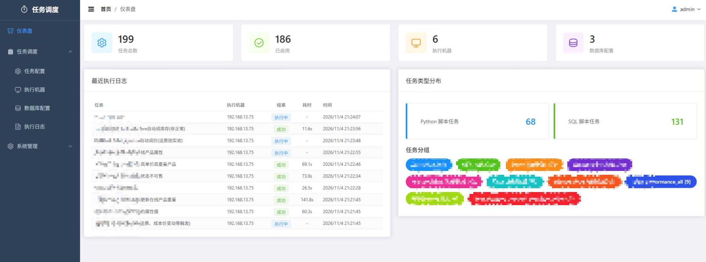
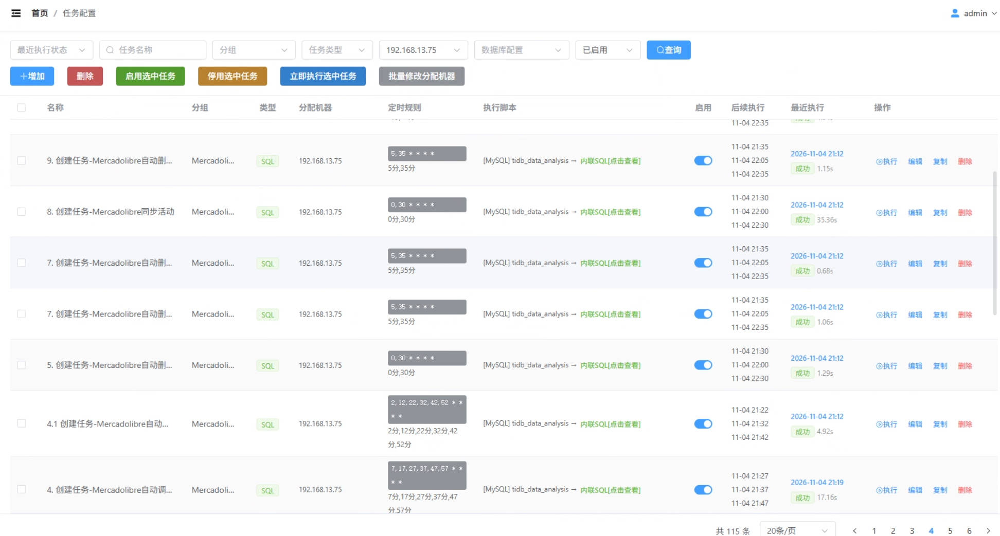
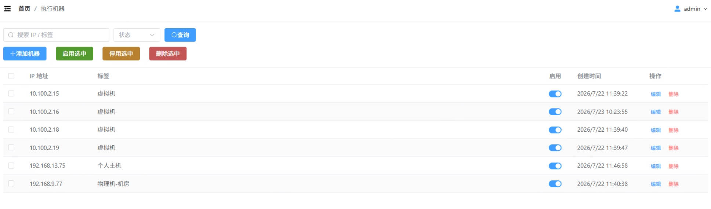
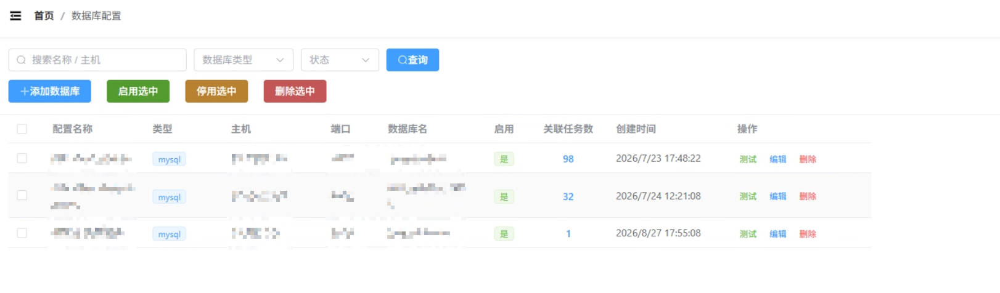

# Django APScheduler 任务调度平台

基于 Django 6.0 + APScheduler 3.x + Vue 3 的任务调度平台，支持 Python 脚本和 SQL 脚本的定时执行与多机分布式部署。

## 目录

- [功能特性](#功能特性)
- [管理后台说明](#管理后台说明)
- [环境要求](#环境要求)
- [快速部署](#快速部署)
- [日志管理](#日志管理)
- [常见问题](#常见问题)
- [附录](#附录)

***

## 功能特性

- 支持 Python / SQL 两种任务类型
- Cron 表达式定时调度
- SQL 内容直接编辑或从文件加载
- 任务执行日志与状态监控
- 超时自动终止
- Vue 3 + Element Plus 前后端分离管理后台
- Windows 服务化部署（开机自启 + 崩溃重启）
- 支持多机分布式部署

***

## 管理后台说明

管理后台地址：`http://<本机IP>:8000/app/`

| 菜单           | 功能                   |
| ------------ | -------------------- |
| 仪表盘         | 任务统计与最近执行概览        |
| 任务调度 → 任务配置  | 管理定时任务（Python / SQL），支持按数据库配置筛选 |
| 任务调度 → 执行机器  | 管理执行机器列表             |
| 任务调度 → 数据库配置 | 管理 SQL 任务的数据库连接，显示关联任务数 |
| 任务调度 → 执行日志  | 查看任务执行历史             |
| 系统管理 → 用户管理 | 管理用户账号与权限            |
| 系统管理 → 分组管理 | 管理用户分组与权限            |

### 界面预览

#### 仪表盘



#### 任务配置



#### 执行机器



#### 数据库配置



### 任务类型

| 类型        | 说明                                     |
| --------- | -------------------------------------- |
| Python 脚本 | 通过 subprocess 调用 Python 解释器执行 `.py` 文件 |
| SQL 脚本    | 通过 sql_runner 连接目标数据库执行 SQL 语句        |

### 执行日志状态

| 状态  | 颜色 | 说明             |
| --- | -- | -------------- |
| 成功  | 绿  | 任务正常执行完成       |
| 失败  | 红  | 脚本报错或异常        |
| 超时  | 橙  | 超过设定的超时时间被强制终止 |
| 中断  | 灰  | 服务重启导致任务中断     |
| 执行中 | 蓝  | 正在执行           |

### 任务配置字段

| 字段       | 说明                  |
| -------- | ------------------- |
| 名称       | 任务唯一标识              |
| 分组       | 任务分组                |
| 任务类型     | Python / SQL        |
| 启用       | 是否启用定时调度            |
| 超时时间(秒)  | 0=不限制，超时后自动终止并标记为超时 |
| 分配机器     | 指定在哪些机器上执行（多机部署时使用） |
| 项目路径     | Python 脚本所在目录       |
| 执行器路径    | 留空=系统全局 Python      |
| 执行脚本     | 需要执行的脚本文件名          |
| SQL 内容   | SQL 任务直接填写的 SQL 语句  |
| Cron 表达式 | 分 时 日 月 周，留空=仅手动触发  |

***

## 环境要求

| 组件     | 要求                                     |
| ------ | -------------------------------------- |
| 操作系统   | Windows 10/11、Windows Server 2016+     |
| Python | 3.10+（推荐 3.12）                         |
| Git    | 任意版本                                    |
| 数据库    | SQLite（内置）或 MySQL 5.7+ / MariaDB 10.3+ |

***

## 快速部署

### 1. 克隆代码

```powershell
git clone https://github.com/Bgods/django_apscheduler.git
cd django_apscheduler
```

### 2. 配置环境

复制 `.env.example` 为 `.env` 并修改：

```powershell
copy .env.example .env
```

主要配置项：
- `SECRET_KEY`：修改为随机字符串
- `NAME`/`USER`/`PASSWORD`/`HOST`/`PORT`：MySQL 数据库配置（多机部署必须使用 MySQL）

### 3. 运行部署脚本

以**管理员身份**运行 `deploy.bat`，脚本自动完成：

1. 环境检查（Git、Python 版本）
2. 下载 NSSM（服务管理工具）
3. 拉取最新代码
4. 创建虚拟环境并安装依赖
5. 数据库迁移
6. 创建管理员账户（首次部署）
7. 注册并启动 Windows 服务

部署完成后访问：`http://localhost:8000/app/`

### 多机部署

每台机器重复上述步骤，确保所有机器的 `.env` 数据库配置一致。

***

## 日志管理

日志文件位于 `logs/` 目录，按天分割，保留 30 天：

| 日志文件              | 内容                |
| ----------------- | ----------------- |
| `server.log`      | 服务通用日志            |
| `error.log`       | 错误日志              |
| `apscheduler.log` | APScheduler 调度器日志 |

***

## 常见问题

### Q1: 服务启动后日志中无调度器启动信息

确保启动参数包含 `--noreload`，否则 Django 的自动重载机制可能导致调度器未在主进程中启动。

### Q2: 新增任务不自动生效

无需重启。任务保存后会通过信号机制自动同步到调度器。

### Q3: ModuleNotFoundError: No module named 'xxx'

需根据任务类型区分安装位置：

- **Python 任务**：依赖包需安装在目标环境的 Python 中
- **SQL 任务**：依赖包需安装在项目 venv 中：
  ```powershell
  .venv\Scripts\activate
  pip install xxx
  ```

### Q4: 管理后台空白

前端产物位于 `tasks/static/app/`，已随代码发布。如缺失请确保代码完整拉取。

***

## 附录

| 文档                                    | 说明               |
| ------------------------------------- | ---------------- |
| [MySQL 安装教程](docs/mysql_setup.md)     | MySQL 数据库安装与配置指南 |
| [多机部署指南](docs/multi_machine_setup.md) | 多机分布式部署配置说明      |
